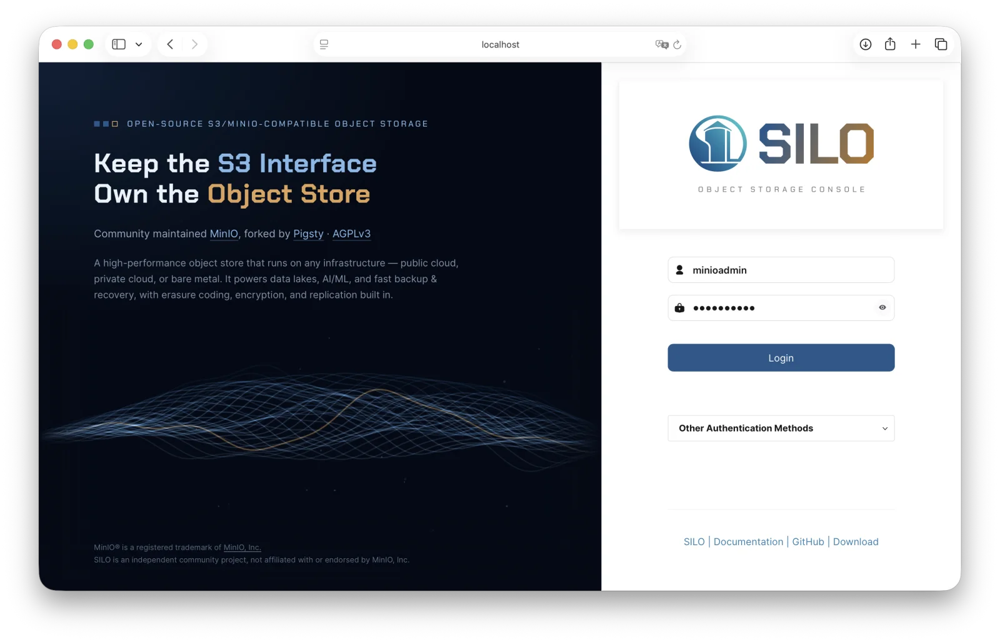
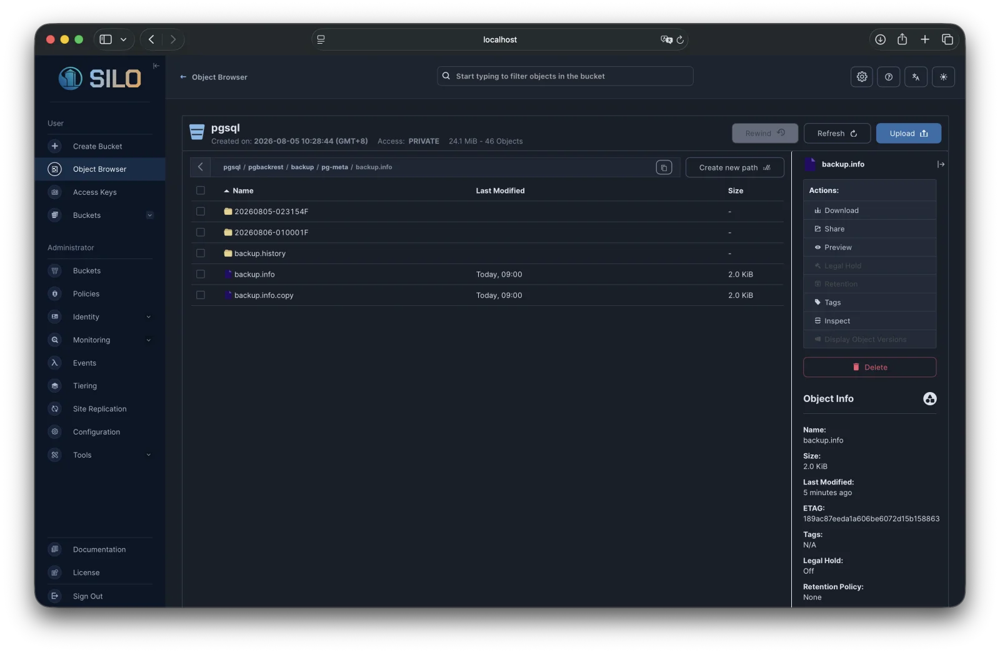
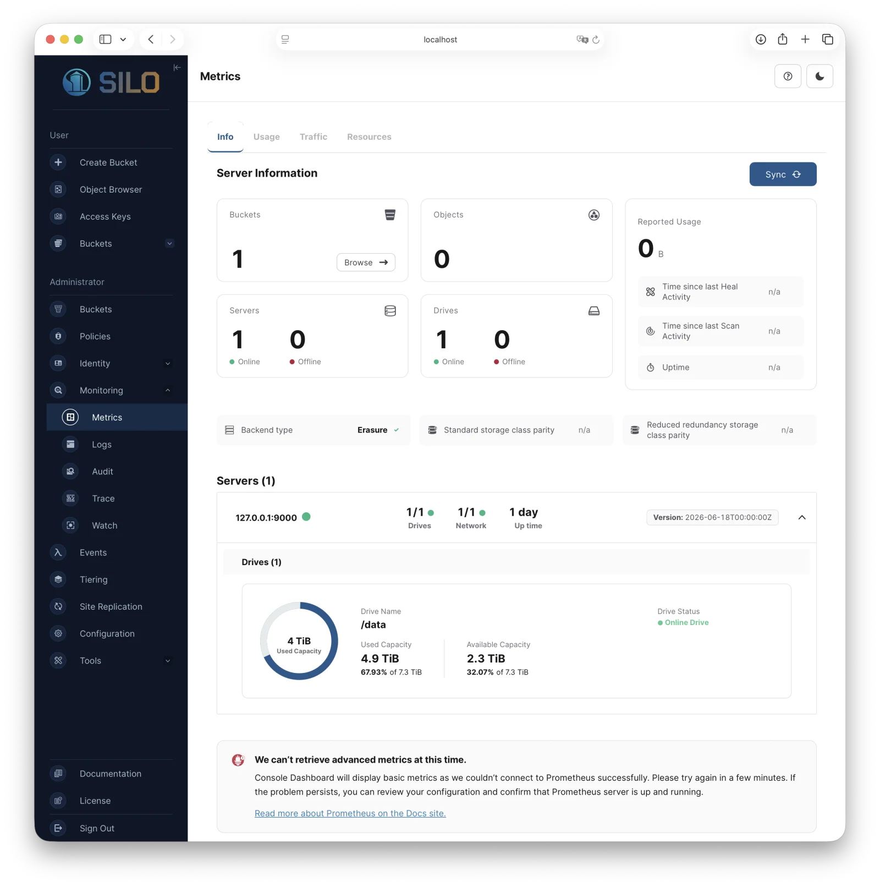

<p align="center">
  <a href="https://silo.pgsty.com/">
    
  </a>
</p>

<h1 align="center">SILO Console</h1>

<p align="center">
  <strong>Web administration console for SILO object storage</strong><br>
  Keep the interface. Own the objects.
</p>

<p align="center">
  <a href="https://silo.pgsty.com/">Website</a> ·
  <a href="https://silo.pgsty.com/docs/">Documentation</a> ·
  <a href="https://github.com/pgsty/silo-console/releases">Download</a> ·
  <a href="https://silo.pgsty.com/tags/console/">Release Notes</a> ·
  <a href="https://silo.pgsty.com/compatibility/console/">Compatibility</a> ·
  <a href="https://silo.pgsty.com/about/security/">Security</a>
</p>

<p align="center">
  <a href="https://silo.pgsty.com/"></a>
  <a href="https://github.com/pgsty/silo-console/releases/latest"></a>
  <a href="go.mod"></a>
  <a href="LICENSE"></a>
</p>

> [!IMPORTANT]
> SILO Console is an independent, community-maintained continuation of the
> former MinIO Console codebase, published by [Pigsty](https://pigsty.io/) for
> [SILO](https://silo.pgsty.com/). It is not affiliated with, endorsed by, or
> sponsored by MinIO, Inc. The MinIO name is used only to identify the upstream
> project and compatibility lineage.

## Version 2.6.0 release candidate

Version 2.6.0 is being prepared for a draft release. Formal publication requires
maintainer approval; v2.5.1 remains the published stable release.

[English](README.md) · [简体中文](README_ZH.md)

**v2.6.0** uses **Go 1.27.3**, **silo-pkg v3.15.2** and the published mcli
20261026 source (`20261026000000.0.0`). Exact dependency commits are recorded in
[hack/deps-release.json](hack/deps-release.json). The upstream SDK is pinned to
`v7.4.2-0.20261025165926-320af050c445`, which accepts successful HTTP 204 responses
when removing bucket replication.

This release adds folder and bucket usage scans with on-demand refresh, durable
worker support, freshness metadata, and retained-version totals. It also hardens
bucket numeric validation, quota and replication handling, locked-bucket
versioning checks, and bucket table layout across widths and fallback fonts.
The Go security graph includes the fixed x/crypto and x/net selections recorded
in `go.mod`; existing policy semantics and output compatibility selections remain.
See [GitHub Releases](https://github.com/pgsty/silo-console/releases) for publication
status and artifacts, and [CHANGELOG.md](CHANGELOG.md#release-v260) for details.

SILO Server 20261026 still embeds Console v2.5.1 and includes the IAM cache repair
required by policy **Reset to default**. Updating standalone Console does not
replace an older Server's embedded Console; adopt a SILO Server release that
selects Console v2.6.0 to coordinate both components.
See the [coordinated release notes](https://silo.pgsty.com/blog/release/silo-20261026/).

## Overview

SILO Console is the browser-based administration interface for
[SILO](https://github.com/pgsty/silo). It combines a React and TypeScript web
application with a Go backend that connects to a SILO or compatible object
storage server.

The Console provides:

- dashboards, health information, logs, diagnostics, and speed tests;
- bucket, object, lifecycle, replication, notification, and tier management;
- users, groups, service accounts, policies, identity providers, and KMS setup;
- server configuration and day-to-day administrative workflows.

The screenshots in this README predate the current-source GUI changes.



> [!NOTE]
> SILO Console is not a generic S3 browser. Its administrative features require
> the MinIO-compatible administration APIs implemented by SILO in addition to
> the S3 API.

## Highlights

### The full administration console

Upstream reduced its community console to an object browser. This project keeps
the complete administrative interface described above — not only object
browsing, but identity, policy, tiering, replication, and observability
management.



### Navigation and everyday operations

After sign-in, current source restores a remembered destination. With no
remembered destination, full-console mode opens Overview (`/overview`) for users
with server-information permission; other users open Buckets (`/buckets`).
Object-browser-only mode defaults to Buckets even for administrators. One
Buckets entry connects object browsing and bucket settings; Identity,
Monitoring, Settings and Tools group the remaining pages.
Existing object deep links remain valid. `/browser` redirects to `/buckets`, and
bare bucket administration links open Summary.

Overview also groups permitted destinations into Tools, Settings, Monitoring and
Identity panels. Help keeps Documentation, Video and Blog/RSS accessible by hover,
click or keyboard; phones retain a visible Help control.

Overview shows health, alerts, data freshness and raw drive capacity reported by
the server. It does not estimate EC usable capacity; missing measurements remain
unknown. Buckets offers sortable tables and compact cards. Object browsing adds
bounded text, Markdown and CSV/TSV previews, keyboard selection and context menus.
Tasks tracks transfers and supported bulk delete/restore operations; a browser
download handoff does not confirm that a file has been saved to disk.

User and policy pages show status, policy sources and direct assignment counts.
Default built-in policies are read-only until explicitly overridden; modified
built-ins can be reset to their defaults.

### Metrics V3 dashboard

The dashboard is built on **MinIO Metrics V3**, the metric set current
deployments actually scrape. All widget queries target the V3 catalog, with
guards for its zero-value and per-node export semantics, so panels distinguish a
real zero from missing data. See [`docs/metrics-v3.md`](docs/metrics-v3.md) for
the mapping.



### A refreshed interface

Current source uses neutral light/dark surfaces, system UI fonts, compact
controls, consistent focus states and reduced-motion support. The original MDS
icons and login hero remain, with Chakra Petch confined to the hero. The existing
React and styled-components stack gains no new UI or animation framework.

Navigation becomes a drawer below 768px and defaults to an icon rail from 768px
to 1199px; an explicit saved sidebar preference takes precedence at widths of
768px and above. Narrow layouts retain page actions and use a sheet for object
details.
The login hero is hidden only below 768px. Temporary-credential (STS) sign-in
remains available independently of configured identity-provider redirects.

### Small, clean, and quiet

The embedded payload went from roughly 10 MB to **about 3 MB**, reproducible byte
for byte and enforced by a release gate. There is **no telemetry** — no
analytics, no beacons, no external scripts or fonts, and no call-home. Automatic
self-update is disabled, and a release catalog is contacted only when one is
explicitly configured.

### Bilingual

The entire interface, including help content and documentation links, is
available in English and Chinese behind a per-page toggle, with no added runtime
dependencies.

## Find the Right Resource

| Looking for | Canonical location |
| :-- | :-- |
| Project overview and navigation | [Silo Website](https://silo.pgsty.com/) |
| Console binaries, packages, and checksums | [GitHub Releases](https://github.com/pgsty/silo-console/releases) |
| Configuration reference | [Environment variables](docs/Environment.md) · [systemd setup](systemd/README.md) · [FAQ](docs/README.md#faq) |
| Release notes for this console | [Console release notes](https://silo.pgsty.com/tags/console/) · [`CHANGELOG.md`](CHANGELOG.md) |
| Differences from the upstream MinIO Console | [Console compatibility notes](https://silo.pgsty.com/compatibility/console/) |
| Metrics V3 dashboard mapping | [`docs/metrics-v3.md`](docs/metrics-v3.md) |
| Development setup and frontend workflow | [`DEVELOPMENT.md`](DEVELOPMENT.md) · [`CONTRIBUTING.md`](CONTRIBUTING.md) |
| Project news and security advisories | [Blog](https://silo.pgsty.com/blog/) · [release](https://silo.pgsty.com/blog/release/) and [security](https://silo.pgsty.com/blog/security/) notes |
| Bug reports and feature discussions | [GitHub Issues](https://github.com/pgsty/silo-console/issues) |
| Vulnerability reporting | [`SECURITY.md`](SECURITY.md) · [Security Policy](https://silo.pgsty.com/about/security/) |
| License, attribution, and trademark information | [`LICENSE`](LICENSE) · [`NOTICE`](NOTICE) · [`CREDITS`](CREDITS) · portal [license](https://silo.pgsty.com/about/license/), [attribution](https://silo.pgsty.com/about/attribution/), and [trademark](https://silo.pgsty.com/about/trademark/) pages |

## Related Projects

| Repository | Description |
| :-- | :-- |
| [`pgsty/silo`](https://github.com/pgsty/silo) | Silo object storage server — the S3-compatible MinIO fork this console administers |
| [`pgsty/silo-console`](https://github.com/pgsty/silo-console) | This repository — the admin web console for the Silo server |
| [`pgsty/mc`](https://github.com/pgsty/mc) | The Silo command-line client, shipped as `mcli` with the `mc` command name |
| [`pgsty/silo-pkg`](https://github.com/pgsty/silo-pkg) | Shared Go packages maintained for the Silo forks |
| [`pgsty/pigsty`](https://github.com/pgsty/pigsty) | Pigsty — the PostgreSQL distribution that ships Silo as its object storage |

## Status and Compatibility

The public project and release name is `silo-console`. Compatibility-sensitive
names are retained where changing them would break existing integrations:

| Surface | Current contract |
| :-- | :-- |
| Repository | [`pgsty/silo-console`](https://github.com/pgsty/silo-console) |
| Release binary | `silo-console` |
| Development build | `./console` |
| Go module | `github.com/minio/console` |
| Server endpoint | `CONSOLE_MINIO_SERVER` |
| Server region | `CONSOLE_MINIO_REGION` |

The retained Go module, import paths, environment variables, API fields, and
protocol identifiers are compatibility interfaces, not product branding. Any
future rename of those interfaces will require aliases and a migration period.

The supported and release-tested stack is `pgsty/silo`, `pgsty/silo-console`,
`pgsty/mc` and `pgsty/silo-pkg`. Compatibility with unmodified upstream MinIO is
best effort and does not replace validation against that maintained stack.

Standalone Console directly requires `github.com/pgsty/silo-pkg/v3` at the
revision selected by `go.mod` and recorded in `hack/deps-release.json`,
and resolves `github.com/minio/minio-go/v7` upstream. The maintained mc source
keeps the compatibility module path `github.com/minio/mc` and lives in
`pgsty/mc`. Console pins an immutable Go pseudo-version: either a published
calendar release or a commit accepted on main with successful CI. The current
selection is the published mcli 20261026 source recorded in
`hack/deps-release.json`. Selecting it
as a dependency does not create another mcli release. An embedding server must
copy this replacement because Go ignores replacements declared by dependency
modules:

<!-- silo-replacements:begin -->
```go
replace (
	github.com/minio/mc => github.com/pgsty/mc v0.0.0-20261026120214-0ceb298cdcd0
)
```
<!-- silo-replacements:end -->

The block above is generated from `go.mod` (`go run ./hack/replacements update`)
and verified on every build (`go run ./hack/replacements check`), so it always
names the exact mc source revision this Console commit builds with. The shared
package is an ordinary direct requirement and needs no downstream replacement:

| Module graph | Status |
| :-- | :-- |
| The single maintained replacement above | Supported; `downstream-embedder-compat` builds a minimal embedder from the published block and verifies the exact `pgsty/silo-pkg` version selected by `go.mod` is inherited directly |
| No mc replacement | Best-effort upstream compatibility signal, tested by the non-blocking `upstream-pkg-compat` job; it is neither the released SILO CLI behavior nor a dependency floor |
| The retired three-replacement graph | Unsupported: do not replace `github.com/minio/pkg/v3` with silo-pkg v3.13.0 or later, whose declared module path is `github.com/pgsty/silo-pkg/v3` |

This is the coordinated own-module-path line introduced by silo-pkg v3.13.0.
Console imports `github.com/pgsty/silo-pkg/v3` directly, while upstream
dependencies that still use `github.com/minio/pkg/v3` may coexist as a distinct
module. Compatibility with unmodified upstream MinIO and mc is maintained on a
best-effort basis and never overrides the SILO dependency graph. See
[docs/Embedding.md](docs/Embedding.md).

The complete, versioned list of differences from the upstream MinIO Console —
restored features, removed features, and known gaps — is maintained in the
[compatibility notes](https://silo.pgsty.com/compatibility/console/).

## Downloads and Release Artifacts

Versioned binaries, packages, checksums, and source archives are published on
[GitHub Releases](https://github.com/pgsty/silo-console/releases).

| Artifact | Location |
| :-- | :-- |
| Source | [`github.com/pgsty/silo-console`](https://github.com/pgsty/silo-console) |
| Standalone binaries | [GitHub Releases](https://github.com/pgsty/silo-console/releases), for Linux (`amd64`, `arm64`, `armv6`), macOS (`amd64`, `arm64`), and Windows (`amd64`) |
| Linux packages | DEB, RPM, and APK for `amd64`, `arm64`, and `armv6`; packages retain the `minio-console.service` compatibility unit and `/etc/default/console` environment file |
| Checksums | `silo-console_<version>_checksums.txt` (SHA-256) alongside each release |

Automatic self-update remains disabled until signed release artifacts and a
tested rollback path are available; upgrade explicitly through a pinned binary
or package version.

### Go and TLS compatibility

Go 1.27 builds require macOS 13 or later. On macOS, builds targeting Go 1.27
replace Keychain trust with on-disk roots and Go's verifier when either
`SSL_CERT_FILE` or `SSL_CERT_DIR` is set. Stale or incomplete CA paths can break
previously trusted connections; unset inherited values to restore Keychain
trust. Certificates in the configured `CAs` directory remain additive to the
selected root pool.

Outbound identity-provider, SILO/STS, and other HTTP connections use Go's default
key exchanges. `GODEBUG=tlsmlkem=0` affects those defaults without disabling
certificate verification; it does not disable ML-DSA signatures.
`GODEBUG=tlssecpmlkem=0` disables only the SecP hybrids and retains X25519MLKEM768.
Console's HTTPS listener explicitly uses P-256 and is unaffected by the hybrid-curve override
change. See the [Go release notes](https://go.dev/doc/go1.27).

## Quick Start

Install the Go version declared in [`go.mod`](go.mod), then build the standalone
Console server:

```bash
git clone https://github.com/pgsty/silo-console.git
cd silo-console
make console
```

Point it at a running SILO server and start the Console:

```bash
export CONSOLE_MINIO_SERVER=http://127.0.0.1:9000
./console server
```

Open <http://127.0.0.1:9090> and sign in with a user from the configured server.
For production, use TLS, configure stable random values for
`CONSOLE_PBKDF_PASSPHRASE` and `CONSOLE_PBKDF_SALT`, and grant users only the
permissions they need. Do not reuse the server root credentials for routine
administration.

If the server uses a region other than `us-east-1`, set the compatibility
variable as well:

```bash
export CONSOLE_MINIO_REGION=your-region
```

See the [environment variable reference](docs/Environment.md),
[systemd setup](systemd/README.md), and [FAQ](docs/README.md#faq) for additional
configuration.

### Frontend Development

The repository includes the generated frontend bundle embedded by the Go
server. For an embedded GUI update, rebuild it after source, tests and
documentation are final:

```bash
make assets
```

Keep generated assets in a separate reviewed commit from source changes.
Building assets does not publish or deploy them. The required Node.js version is
recorded in [`.nvmrc`](.nvmrc). See [`web-app/README.md`](web-app/README.md) for the
source workspace, bundle gates and GUI regression runner, and
[`DEVELOPMENT.md`](DEVELOPMENT.md) for the local server workflow.

## Maintenance Scope

SILO Console follows the conservative maintenance model of the SILO server. The
active line focuses on:

- compatibility with the maintained SILO server;
- applicable security and dependency updates;
- focused fixes for reproducible defects;
- release engineering, tests, documentation, and operational continuity.

Maintenance is best effort. No response time, remediation schedule, support
window, commercial support, or SLA is guaranteed. Pin versions, review changes,
keep a rollback path, and test upgrades before production use.

## Background

The upstream MinIO Console was reduced to an object browser and its community
maintenance ended. Pigsty maintains this continuation because SILO needs a
complete, reproducible administration console rather than depending on an
archived upstream line. The broader upstream changes and the fork maintenance
record are documented in these essays:

| Essay | Subject |
| :-- | :-- |
| [MinIO Is Dead](https://silo.pgsty.com/blog/post/minio-is-dead/) | Changes to the upstream project and distribution model |
| [MinIO Is Dead, Who Takes Over?](https://silo.pgsty.com/blog/post/minio-alternative/) | Alternatives considered |
| [MinIO Is Dead, Long Live MinIO](https://silo.pgsty.com/blog/post/minio-resurrect/) | Establishing the server and client release pipeline |
| [Two months into maintaining a MinIO fork](https://silo.pgsty.com/blog/post/minio-promise-kept/) | Initial security and maintenance work |

## Security and Contributing

Report security issues privately as described in [`SECURITY.md`](SECURITY.md).
For ordinary defects and feature work, open an
[issue](https://github.com/pgsty/silo-console/issues) or follow
[`CONTRIBUTING.md`](CONTRIBUTING.md). Useful contributions include security and
dependency updates, compatibility fixes, tests, release automation,
documentation, and accessibility improvements.

## Contributors

<!-- Generated by silo.pgsty.com/bin/contributors.py. -->

As of **2026-11-04**, **5 contributors** are credited in this repository. Every human issue or PR author counts, regardless of merge status. Merged fixes, adopted proposals, and actionable reports receive priority, with first participation guiding the remaining order. Gold rings highlight significant contributions.

<p align="center">
<a href="https://github.com/Vonng"></a>
<a href="https://github.com/cyberbret"></a>
<a href="https://github.com/kh0mka"></a>
<a href="https://github.com/jiri-pejchal"></a>
<a href="https://github.com/azataiot"></a>
</p>

[View the contribution record](CONTRIBUTORS.md), including actual PR status and work incorporated through later fixes.

## License, Attribution, and Trademarks

SILO Console is free software distributed under the
[GNU Affero General Public License v3.0 or later](LICENSE). See [`NOTICE`](NOTICE)
and [`CREDITS`](CREDITS) for notices and third-party license information.

This repository contains code derived from the former MinIO Console and carried
forward through the [`Alevsk/console`](https://github.com/Alevsk/console) and
[`georgmangold/console`](https://github.com/georgmangold/console) community
maintenance lines. Copyright in inherited code remains with MinIO, Inc. and the
respective contributors; SILO-specific modifications remain copyright their
respective authors. Existing copyright, license, and attribution notices must
be kept intact.

MinIO® is a registered trademark of MinIO, Inc. SILO and SILO Console are
independent community projects and are not affiliated with, endorsed by, or
sponsored by MinIO, Inc. Amazon S3 is a trademark of Amazon.com, Inc. or its
affiliates; references to S3 describe protocol compatibility only. All other
trademarks are the property of their respective owners.
