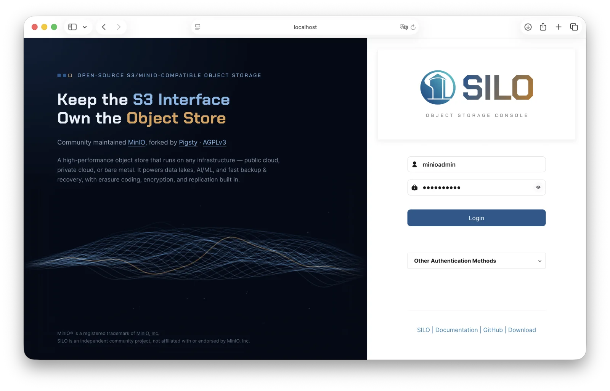

<p align="center"><a href="https://silo.pgsty.com/zh/"></a></p>

# SILO Console

[English](README.md) · [简体中文](README_ZH.md)

SILO 对象存储的 Web 管理控制台，由 Pigsty 社区维护。前端使用 React/TypeScript，Go 后端连接 SILO，提供存储桶、对象、身份、策略、复制、生命周期、分层、通知、诊断与监控管理。

这是从开源 MinIO Console 延续而来的独立项目，与 MinIO, Inc. 无隶属、赞助或背书关系。MinIO 名称用于说明上游来源与兼容谱系。

## SILO Console 2.7.0

当前源码准备 **2.7.0**：十种语言与阿拉伯语 RTL、独立缓存的语言资源、容器 HTTPS 与临时文件修复，以及 Go 依赖和 API 文档更新。
制品通过标签流水线准备为 GitHub Draft Release；草稿公开发布前，最新正式版仍为
[v2.6.0](https://github.com/pgsty/silo-console/releases/tag/v2.6.0)。

**2.7.0** 使用 **Go 1.27.3**、**silo-pkg v3.16.0** 与 **mcli 20261109 正式版**。
MC 的 `RELEASE.2026-11-09T00-00-00Z` 是日历标签，Go 用伪版本
`v0.0.0-20261109021353-e1d4cc5abfe0` 表示其准确发布提交。
保留 `github.com/minio/mc` 导入路径，通过 replace 选择 `github.com/pgsty/mc` 的正式源码；
这不是发布前快照或浮动分支。精确提交、伪版本与标签见[发布依赖记录](hack/deps-release.json)。
Console v2.6.0 的[历史依赖记录](https://github.com/pgsty/silo-console/blob/v2.6.0/hack/deps-release.json)
仍为 silo-pkg v3.15.2 与 mcli 20261026。上游 SDK 继续固定为
`v7.4.2-0.20261025165926-320af050c445`，修复删除桶复制配置时误将 HTTP 204 当作失败的问题。

Console v2.6.0 已加入目录与存储桶用量扫描、按需刷新、持久化后台任务、数据新鲜度元数据和保留版本统计，
并强化存储桶数值校验、配额与复制处理、锁定桶版本控制检查，以及不同宽度和字体下的表格布局。
Go 安全依赖图同步采用 `go.mod` 中修复后的 x/crypto 与 x/net 版本，保留既有策略语义和输出格式兼容性例外。
发布状态与制品见 [GitHub Releases](https://github.com/pgsty/silo-console/releases)，
2.7.0 变化见 [CHANGELOG.md](CHANGELOG.md#release-v270)。

SILO Server 20261026 仍内嵌 Console v2.5.1，并包含策略“恢复默认”所需的 IAM 缓存修复。
更新独立 Console 不会替换旧 Server 的内嵌 Console；Server 选择相应 Console 源码并发布后，内嵌界面才会获得这些变化。
详见[联合发布说明](https://silo.pgsty.com/zh/blog/release/silo-20261026/)。

## 功能与兼容范围

- 保留完整管理控制台：仪表盘、健康、日志、诊断、测速、桶与对象管理、用户／组／服务账户、身份提供方、复制、通知、分层和 KMS。
- Metrics V3 仪表盘区分零值与缺失指标，详细映射见 [Metrics V3](docs/metrics-v3.md)。
- 支持英语、简体中文、法语、德语、俄语、西班牙语、巴西葡萄牙语、日语、阿拉伯语与土耳其语，保留开源管理能力及既有协议、环境变量与模块路径。
- 正式维护和发布测试目标为 `pgsty/silo`；对未经修改的上游 MinIO 兼容尽最大努力。它使用 SILO 的管理 API，不是适用于任意 S3 后端的通用浏览器。

以下截图早于当前源码的 GUI 更新。



升级前核对[密码权限迁移](https://silo.pgsty.com/zh/compatibility/password-permissions/)。`admin:ChangeMyPassword` 与 `admin:CreateUser` 表达不同操作，客户端界面不能替代服务端授权。

### 多语言界面

登录页、公开页面和登录后的控制台共用语言菜单，命令面板提供相同选项。
英语是默认与回退语言，用户的显式选择会被记住。九个翻译词典分别压缩并随应用全量加载，
带内容哈希的资源缓存一年；加载后可离线切换，未保存的表单内容保持不变。
中文保持完整覆盖，其他语言缺失的条目回退到英文。
阿拉伯语使用从右向左布局，路径、桶名、策略 JSON 和日志保留原有方向与内容。
感谢 [@EduardoAndradeMachado](https://github.com/EduardoAndradeMachado) 在
[PR #83](https://github.com/pgsty/silo-console/pull/83) 中贡献巴西葡萄牙语翻译。

## 下载与运行

从 [GitHub Releases](https://github.com/pgsty/silo-console/releases) 下载二进制、归档、Linux 软件包或源码。发布制品附带 SHA-256、SBOM 和签名来源证明，验证规则见[发布契约](docs/release-contract.md)。官方下载入口也见[网站下载页](https://silo.pgsty.com/zh/download/#console)。

官方容器仅使用 `docker.io/pgsty/silo-console`；部署时固定已公开验收的版本或镜像摘要，不以滚动标签代替版本记录。

本地使用下载的 Linux amd64 独立二进制连接运行中的 SILO：

```bash
chmod +x silo-console-linux-amd64
export CONSOLE_MINIO_SERVER=http://127.0.0.1:9000
./silo-console-linux-amd64 server
```

打开 [http://127.0.0.1:9090](http://127.0.0.1:9090)，使用目标 Server 的用户登录。生产环境启用 TLS，配置稳定、随机的 `CONSOLE_PBKDF_PASSPHRASE` 和 `CONSOLE_PBKDF_SALT`，按最小权限授权；日常管理不要复用 Server root 凭据。Server 区域不是 `us-east-1` 时，设置 `CONSOLE_MINIO_REGION`。

参见[环境变量](docs/Environment.md)、[systemd 配置](systemd/README.md)与 [FAQ](docs/README.md#faq)。SILO Server 自带嵌入式 Console，已有部署不必为了升级 Server 额外运行独立 Console。

## 源码与开发

按 `go.mod` 安装工具链，然后构建当前源码：

```bash
git clone https://github.com/pgsty/silo-console.git
cd silo-console
make console
CONSOLE_MINIO_SERVER=http://127.0.0.1:9000 ./console server
```

保留的 Go 模块路径没有 `/v2` 后缀。当前候选源码的依赖与 replacement 见 [Embedding.md](docs/Embedding.md) 和[英文 README](README.md#status-and-compatibility)。嵌入时使用所选提交的 Go 伪版本，并显式复制 MC replacement；Go 不会继承依赖的替换配置。共享代码直接使用 `github.com/pgsty/silo-pkg/v3`；经 `minio/colorjson` 引入的间接 `minio/pkg/v3` 保持独立，不替换为 silo-pkg。

前端开发见 [DEVELOPMENT.md](DEVELOPMENT.md) 与 [web-app/README.md](web-app/README.md)。工具链及 TLS 兼容细节、功能截图和维护范围见[英文 README](README.md)。

## 贡献者

<!-- Generated by silo.pgsty.com/bin/contributors.py. -->

截至 **2026-11-09**，本仓库记录了 **6 位贡献者**。提交 issue 或 PR 即认可为贡献，不以合并为前提；已合并的修复、被采纳的方案和有效报告优先展示，其余参考首次参与时间。金色圆环突出显著贡献。

<p align="center">
<a href="https://github.com/Vonng"></a>
<a href="https://github.com/cyberbret"></a>
<a href="https://github.com/EduardoAndradeMachado"></a>
<a href="https://github.com/kh0mka"></a>
<a href="https://github.com/jiri-pejchal"></a>
<a href="https://github.com/azataiot"></a>
</p>

[查看完整贡献记录](CONTRIBUTORS.md)，包括实际 PR 状态与后续采纳情况。

## 项目与贡献

配套项目：[SILO Server](https://github.com/pgsty/silo)、[mcli](https://github.com/pgsty/mc)、[共享包](https://github.com/pgsty/silo-pkg)、[可选 KES](https://github.com/pgsty/kes)、[双语文档](https://silo.pgsty.com/zh/)。

安全问题按 [SECURITY.md](SECURITY.md) 报告；贡献遵循 [CONTRIBUTING.md](CONTRIBUTING.md)，使用 `git commit -s` 签署 DCO。无需 CLA，保留原作者版权、许可证与署名。贡献记录见 [CONTRIBUTORS.md](CONTRIBUTORS.md)。本项目采用 [AGPL-3.0-or-later](LICENSE)，第三方材料保留各自许可与归属声明。
